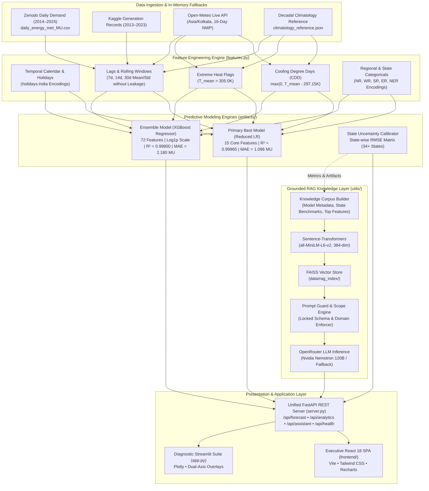
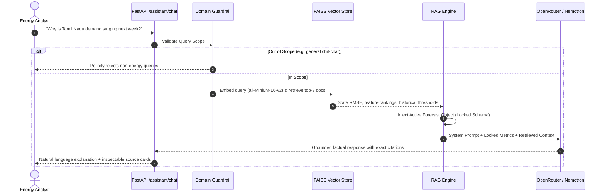

# ⚡ Loadly — Intelligent Power Demand Forecasting & Grid Analytics Platform

<div align="center">


<br/>

**State-level electricity demand forecasting across India powered by meteorological intelligence, thermal surge modeling, dual ML engines, and a domain-grounded conversational RAG assistant.**

[Key Capabilities](#-key-capabilities) • [System Architecture](#-system-architecture) • [ML Models & Benchmarks](#-ml-models--benchmarks) • [Meteorological Intelligence](#-meteorological-intelligence--thermal-surge-engine) • [RAG AI Assistant](#-grounded-conversational-ai-assistant-rag) • [Executive Design System](#-executive-design-system-executive-thermal-surge) • [Repository Structure](#-repository-structure) • [Quick Start](#-quick-start) • [API Documentation](#-api-documentation) • [Testing & QA](#-testing--quality-assurance) • [Roadmap](#-roadmap)

</div>

---

## 📌 Executive Summary

**Loadly** (Smart Energy Forecasting Platform — Stage 1.5: *Forecast + Explain*) is an enterprise-grade power demand forecasting and grid analytics solution engineered for the Indian National Power System. It bridges the critical divide between offline statistical modeling and mission-critical decision support for State Electricity Distribution Companies (**DISCOMs**), Regional Load Despatch Centres (**RLDCs**), and energy policy analysts.

By ingesting decadal historical electricity consumption records across all **36 Indian States and Union Territories**, historical ERA5 reanalysis weather data, and live real-time forecasts from the Open-Meteo API, Loadly produces high-fidelity daily demand forecasts across **7, 14, and 30-day horizons**. Each forecast is paired with **state-specific 90% confidence uncertainty envelopes**, dynamic thermal surge detection (**Cooling Degree Days** and **Extreme Heat Alerts**), and an explainable, **domain-grounded RAG Assistant** that answers complex operational and meteorological questions without hallucination.

### The Problem It Solves
1. **Extreme Climate Sensitivity**: The Indian power grid experiences severe weather-induced demand shocks. Rising heatwaves and escalating air conditioning penetration cause non-linear load surges during summer, followed by dramatic swings during the monsoon. Traditional autoregressive models fail to anticipate these tipping points.
2. **The "Black-Box" Interpretability Deficit**: Grid controllers cannot act on raw machine learning predictions without knowing *why* a peak is forecasted and *which* weather variables drive the surge.
3. **Training–Inference Discrepancies**: ML prototypes often suffer from feature leakage or temporal misalignment between offline research notebooks and production REST APIs. Loadly implements strict feature parity with historical lag handling and automated fallback baselines.

---

## ✨ Key Capabilities

| Pillar | Features |
| :--- | :--- |
| **📈 Multi-Horizon Forecasting** | • Daily demand forecasts for **7, 14, and 30 days** across all 36 Indian states and UTs.<br/>• State-specific **90% confidence intervals** ($\pm z \cdot \text{RMSE}_{\text{state}}$).<br/>• Automatic peak and trough detection (Million Units / MU) and date identification. |
| **🌡️ Thermal Surge & Climate Engine** | • Live ingestion of **2m temperature (min/mean/max)**, dewpoint, wind speed ($u, v$ vectors), shortwave solar radiation, cloud cover, and Steadman heat index / UTCI.<br/>• **Cooling Degree Days (CDD)** modeling with base threshold $297.15\,\text{K}$ ($24.0^\circ\text{C}$).<br/>• **Extreme Heat Surge Alerts** pegged to an empirical threshold of $> 305.0\,\text{K}$ ($31.85^\circ\text{C}$) where non-linear cooling load inflections occur.<br/>• Smart weather blending: days 1–16 from live satellite/NWP forecasts, stitched with decadal climatological profiles for days 17–30. |
| **🤖 Grounded AI Energy Assistant** | • Fully local **FAISS CPU** vector store (384 dimensions) populated with state benchmarks, model error profiles, and feature importances.<br/>• Local embeddings via `sentence-transformers` (`all-MiniLM-L6-v2`) with zero external API dependencies required.<br/>• LLM inference via **OpenRouter** (`nvidia/nemotron-3-super-120b-a12b:free`).<br/>• **Locked Forecast Schema**: Strictly forbids LLM metric hallucinations; guarantees numerical accuracy.<br/>• Domain scope validator enforcing grid and energy context. |
| **🖥️ Dual Presentation Interfaces** | • **Executive React 18 SPA**: Built with Vite, Tailwind CSS, Recharts, and Lucide React. Features interactive timeline graphs, health modals, dark/light themes, and CSV export.<br/>• **Analytical Streamlit Diagnostics Suite**: Interactive Plotly charts, correlation matrices, seasonal historical benchmarks, and live chat interface. |
| **⚡ Production API & Observability** | • Asynchronous **FastAPI** backend with Pydantic v2 validation and CORS security.<br/>• Built-in `/api/health` monitoring model status, FAISS store readiness, and weather provider uptime.<br/>• Multi-stage **Docker** build packaging both React frontend and Python backend into a unified container image. |

---

## 🏗️ System Architecture



---

## 📊 ML Models & Benchmarks

Loadly maintains two complementary modeling approaches saved in `artifacts/`:
1. **Primary Production Model (`best_model.pkl`)**: A **15-feature Reduced Linear Regression** model that optimizes for low latency, zero collinearity drift, and exceptional generalization across all states.
2. **High-Dimensional Gradient Boosting Model (`xgb2_model.pkl`)**: An **XGBoost Regressor** trained on 72+ features using a $\log(1 + y)$ target transformation and historical cross-validation.

### Performance Comparison

| Metric | Primary Model (`Reduced_LR`) | XGBoost Pipeline (`XGB2_Log`) | Benchmark Standard |
| :--- | :---: | :---: | :--- |
| **$R^2$ Score** | **0.99965** | **0.99800** | $\ge 0.950$ (PRD target) |
| **MAE (Mean Absolute Error)** | **1.096 MU** | **2.180 MU** | Daily error across states |
| **RMSE (Root Mean Squared Error)**| **2.628 MU** | **4.580 MU** | National test set |
| **Input Feature Dimensionality** | **15 Features** | **72 Features** | Compact vs One-Hot |
| **Inference Latency** | **< 2 ms** | **~ 12 ms** | Point prediction pass |

### The 15 Core Features of the Primary Model

The primary model eliminates noisy high-dimensional sparse state dummies in favor of high-signal rolling demand and thermal indicators:

| # | Feature Identifier | Category | Physical & Operational Meaning |
| :-: | :--- | :--- | :--- |
| 1 | `demand_roll_mean_7` | Demand History | 7-day rolling average demand (captures immediate weekly baseline) |
| 2 | `demand_roll_mean_14` | Demand History | 14-day rolling average demand (captures bi-weekly momentum) |
| 3 | `demand_roll_mean_30` | Demand History | 30-day rolling baseline (stabilizes seasonal trend) |
| 4 | `demand_roll_std_7` | Volatility | 7-day standard deviation of load (weekly consumption variance) |
| 5 | `demand_roll_std_30` | Volatility | 30-day standard deviation of load (macro-level grid volatility) |
| 6 | `daily_change` | Momentum | Day-over-day absolute demand differential ($\Delta \text{MU}_{t - t-1}$) |
| 7 | `daily_pct_change` | Momentum | Day-over-day percentage demand fluctuation |
| 8 | `2m_temperature_mean` | Weather | Daily mean ambient temperature at 2 meters (Kelvin) |
| 9 | `2m_temperature_max` | Weather | Daily maximum peak temperature (Kelvin) |
| 10 | `temperature_lag_1` | Weather Lag | Previous day's mean temperature (thermal inertia of buildings) |
| 11 | `temp_range` | Weather Dynamics | Diurnal temperature swing ($T_{\max} - T_{\min}$) |
| 12 | `CDD` | Thermal Stress | Cooling Degree Days: $\max(0, T_{\text{mean}} - 297.15\,\text{K})$ |
| 13 | `month` | Calendar | Cyclical annual month indicator (1–12) |
| 14 | `day_of_week` | Calendar | Day index (Monday = 0 ... Sunday = 6) |
| 15 | `is_weekend` | Calendar | Binary indicator for commercial/industrial weekend load reduction |

### State-Specific Uncertainty Modeling (90% Confidence Interval)

Because Indian states vary drastically in grid scale—from island union territories consuming $< 2\,\text{MU/day}$ to mega-industrial states consuming $> 450\,\text{MU/day}$—Loadly rejects global confidence intervals. Instead, predictions use a state-specific variance matrix calibrated on out-of-sample residuals:

$$\text{Confidence Interval}_{90\%} = \hat{y}_t \pm \left(z_{0.90} \times \text{RMSE}_{\text{state}}\right) \quad \text{where } z_{0.90} \approx 1.645$$

#### Representative State RMSE Benchmarks

| State / UT | Daily Baseline | State RMSE | 90% Uncertainty Margin ($\pm\text{MU}$) |
| :--- | :---: | :---: | :---: |
| **Sikkim** | ~ 10 MU | **0.025 MU** | $\pm 0.041\text{ MU}$ |
| **Chandigarh** | ~ 8 MU | **0.115 MU** | $\pm 0.189\text{ MU}$ |
| **Himachal Pradesh** | ~ 40 MU | **0.813 MU** | $\pm 1.337\text{ MU}$ |
| **Kerala** | ~ 100 MU | **1.789 MU** | $\pm 2.943\text{ MU}$ |
| **Bihar** | ~ 200 MU | **2.353 MU** | $\pm 3.871\text{ MU}$ |
| **Tamil Nadu** | ~ 300 MU | **4.448 MU** | $\pm 7.317\text{ MU}$ |
| **Uttar Pradesh** | ~ 350 MU | **8.822 MU** | $\pm 14.512\text{ MU}$ |
| **Gujarat** | ~ 250 MU | **13.583 MU** | $\pm 22.344\text{ MU}$ |
| **Maharashtra** | ~ 400 MU | **42.000 MU** | $\pm 69.090\text{ MU}$ |

---

## 🌡️ Meteorological Intelligence & Thermal Surge Engine

### Live Open-Meteo Integration
Loadly connects directly to the Open-Meteo Global Forecasting API without requiring external API keys. Geographic coordinates (`lat`, `lon`) are calibrated to the geographic centroids of all 36 Indian states and union territories (`config.py`).

* **Hourly to Daily Aggregation**: Ingests maximum, minimum, and mean 2-meter air temperatures, mean 2-meter dewpoint, 10-meter wind speed and direction, shortwave downward solar radiation, and fractional cloud cover.
* **Kelvin Standardization**: The API's native Celsius metrics are transformed into Kelvin ($T_{\text{Kelvin}} = T_{\text{Celsius}} + 273.15$) to match ERA5 training distributions.
* **Wind Vector Components**: Converts scalar wind speed ($s$) and dominant direction degrees ($\theta$) into orthogonal Eulerian coordinates:
  $$u_{10\text{m}} = -s \cdot \sin(\theta_{\text{rad}}), \quad v_{10\text{m}} = -s \cdot \cos(\theta_{\text{rad}})$$
* **Steadman Thermal Comfort Index (UTCI Approximation)**: Computes apparent ambient stress combining temperature, relative humidity, and wind chill.

### Thermal Surge Thresholds
1. **Cooling Degree Days ($\text{CDD}$)**:
   $$\text{CDD} = \max\left(0, T_{\text{mean}} - 297.15\,\text{K}\right) \quad (\text{Base: } 24.0^\circ\text{C})$$
   Quantifies the cumulative cooling load required by commercial air conditioning and residential fans.
2. **Extreme Heat Stress Alert Threshold**:
   Peaked at **$305.0\,\text{K}$ ($31.85^\circ\text{C}$)** mean daily temperature. When ambient temperature crosses this mark, refrigeration compressor efficiency drops while AC duty cycles spike continuously, triggering non-linear grid demand surges.

### Hybrid Weather Horizon Stitching
While numerical weather prediction (NWP) models deliver high reliability up to 16 days, accuracy declines beyond that horizon. Loadly implements a **two-phase hybrid weather blending engine**:
* **Horizon 1 to 16 Days**: 100% dynamic live NWP forecast from Open-Meteo.
* **Horizon 17 to 30 Days**: Automatically stitches days 17–30 with precomputed decadal monthly climatological baselines from `artifacts/climatology_reference.json`.
* **Zero-Downtime Offline Fallback**: If Open-Meteo times out or network connectivity fails, the pipeline seamlessly transitions to historical climatology without disrupting user workflows.

---

## 🤖 Grounded Conversational AI Assistant (RAG)

Traditional LLM implementations frequently hallucinate power figures, invent phantom peak dates, or misquote capacity statistics. Loadly solves this with an authoritative, grounded **Retrieval-Augmented Generation (RAG)** pipeline.



### Key Architectural Safeguards
1. **Locked Forecast Schema (`prompts/assistant.md`)**: The active forecast object (e.g., `avg_demand`, `peak_demand`, `peak_date`, `high_risk_days_count`, `high_risk_dates`, `state_rmse`) is injected as a read-only immutable block. The LLM prompt explicitly forbids recalculating, approximating, or inferring any metric.
2. **Local FAISS Vector Database**: Stored under `data/rag_index/` using 384-dimensional dense vectors indexed with L2 distance. Embeddings are generated locally with `sentence-transformers/all-MiniLM-L6-v2`, requiring zero third-party API keys or subscription fees.
3. **Domain Scope Filter**: `is_query_in_scope()` uses semantic keyword evaluation to intercept off-topic questions (e.g., general news, sports, coding tasks) before invoking embedding generation or LLM tokens.
4. **Inspectable Source Attribution**: Every response returned by `/api/assistant/chat` includes exact text snippets and metadata cards indicating the provenance of the information.

---

## 🎨 Executive Design System ("Executive Thermal Surge")

The platform is styled using the custom **Executive Thermal Surge** design system (`THEME.md`), combining the authoritative precision of power utility control rooms with vivid thermal alert dynamics.

### Palette Tokens

```text
Light Mode (Executive Daylight)            Dark Mode (Executive Midnight)
──────────────────────────────             ─────────────────────────────
Primary Demand:    #1E3A8A (Sovereign Navy)  Primary Demand:    #38BDF8 (Luminous Cyan)
Uncertainty Band:  rgba(30, 58, 138, 0.12)   Uncertainty Band:  rgba(56, 189, 248, 0.18)
Weather Temp:      #EA580C (Solar Flare)     Weather Temp:      #FFB703 (Solar Gold)
Heat Surge Alert:  #E11D48 (Molten Crimson)  Heat Surge Alert:  #FF4D6D (Neon Coral)
CDD Bar Fill:      rgba(225, 29, 72, 0.28)   CDD Bar Fill:      rgba(255, 77, 109, 0.32)
Historical 7d:     #64748B (Steel Slate)     Historical 7d:     #64748B (Steel Slate)
Background:        #F8FAFC (Executive Slate) Background:        #0A0F1D (Navy Abyss)
Cards / Sidebars:  #FFFFFF (Pure White)      Cards / Sidebars:  #131C31 (Indigo Slate)
```

---

## 📁 Repository Structure

```text
Loadly/
├── api/                                # FastAPI application layer
│   ├── __init__.py                     # Package initialization
│   ├── routes.py                       # REST route controllers & business logic
│   └── schemas.py                      # Pydantic v2 request/response contracts
├── artifacts/                          # Persisted models & offline reference tables
│   ├── best_model.pkl                  # Primary model (15-feature Reduced Linear Regressor)
│   ├── xgb1_model.pkl                  # Full-featured baseline XGBoost model
│   ├── xgb2_model.pkl                  # Production 72-feature XGBoost regressor (log-scale)
│   ├── model_metadata.json             # State RMSE values, thresholds & metrics
│   └── climatology_reference.json      # 12-month weather averages for 36 states/UTs
├── data/                               # Local data directory (git-ignored)
│   ├── daily_energy_met_MU.csv         # Historical demand records (2014-2024)
│   ├── sample_cleaned_dataset.csv      # 100-row testing sample
│   └── rag_index/                      # Persisted FAISS index & metadata
├── docs/                               # Project documentation & design specs
│   └── prd.md                          # Product Requirements Document (Stage 1.5)
├── frontend/                           # Executive React 18 frontend (Vite + Tailwind)
│   ├── public/                         # Public web assets and favicon
│   ├── src/                            # React application source code
│   │   ├── assets/                     # Graphic assets
│   │   ├── components/                 # Reusable UI component library
│   │   │   ├── AssistantTab.jsx        # Grounded RAG conversational interface
│   │   │   ├── ElectricityTowerBg.jsx  # Ambient animated transmission tower SVG
│   │   │   ├── ForecastTab.jsx         # Time-series demand forecasting view
│   │   │   ├── Navbar.jsx              # Header, state selector & theme controls
│   │   │   ├── SystemHealthModal.jsx   # Live system diagnostics modal
│   │   │   └── WeatherImpactTab.jsx    # Thermal correlation & feature importance
│   │   ├── services/                   # API client bindings
│   │   ├── App.jsx                     # Root application container & tab router
│   │   ├── index.css                   # Tailwind CSS utilities and theme variables
│   │   └── main.jsx                    # React 18 DOM bootstrap
│   ├── package.json                    # Node dependencies & npm scripts
│   ├── tailwind.config.js              # Theme color definitions & dark mode classes
│   └── vite.config.js                  # Vite bundler & reverse proxy configuration
├── memory/                             # Project memory & retrospectives
│   └── content-log.md                  # Development history and retrospectives
├── notebooks/                          # Research, exploratory analysis & training
│   ├── 01_data_preprocessing.ipynb     # Zenodo/Kaggle dataset cleaning & merging
│   ├── 02_eda.ipynb                    # Exploratory analysis & seasonal trends
│   ├── 03_feature_engineering.ipynb    # Lag, rolling, CDD, and interaction creation
│   └── 04_model_training.ipynb         # Time-series CV, hyperparameter tuning & export
├── prompts/                            # System prompts for AI components
│   └── assistant.md                    # Strict schema-locked prompt for RAG assistant
├── tests/                              # Automated test suite (Pytest)
│   ├── __init__.py                     # Package initialization
│   ├── conftest.py                     # Shared Pytest fixtures and mock data
│   ├── test_api.py                     # FastAPI endpoint integration tests
│   ├── test_features.py                # Feature calculation & encoding test suite
│   ├── test_integration.py             # End-to-end forecasting pipeline validation
│   ├── test_lag_computation.py         # Temporal shift & no-forward-leakage tests
│   └── test_rag_engine.py              # FAISS indexing & query scope tests
├── ui/                                 # Analytical Streamlit interface components
│   ├── assistant_tab.py                # Streamlit RAG chat interface
│   ├── forecast_tab.py                 # Streamlit forecast charts & schedule table
│   └── weather_tab.py                  # Streamlit correlation & seasonal views
├── utils/                              # Data ingestion, health & vector store utilities
│   ├── bridge_gap_2024_2025.py         # Pipeline to bridge historical demand gaps
│   ├── embeddings.py                   # Local Sentence-Transformers & OpenRouter wrapper
│   ├── extend_demand_sequence.py       # Sequential demand series synthesizer
│   ├── fetch_recent_weather.py         # Bulk weather collector from Open-Meteo
│   ├── health_checks.py                # Health verification routines (Model, RAG, API)
│   ├── health_monitor.py               # Singleton state tracker for system health
│   ├── ingest_2023_2024_demand.py      # Recent demand parser
│   ├── parse_psp_reports.py            # National Grid Power Supply Position parser
│   ├── rag_builder.py                  # Document chunking & vector store builder
│   ├── rag_engine.py                   # Context retriever & LLM query pipeline
│   ├── test_grid_api.py                # Live weather API verification script
│   ├── train_pipeline.py               # Automated pipeline retraining orchestrator
│   ├── update_demand_data.py           # Incremental demand data updater
│   ├── update_notebooks.py             # Notebook artifact updater
│   └── vector_store.py                 # FAISS vector store manager
├── .dockerignore                       # Exclusions for Docker build context
├── .env                                # Local environment secrets (ignored by Git)
├── .gitignore                          # Standard git ignore definitions
├── .pre-commit-config.yaml             # Code formatting and linting hooks
├── analyze_thresholds.py               # Empirical anomaly and heat threshold analyzer
├── app.py                              # Streamlit application entry point
├── config.py                           # State coordinates and regional taxonomy
├── data_loading.py                     # Demand, weather, and climatology data loaders
├── Dockerfile                          # Multi-stage production container definition
├── features.py                         # Production feature engineering pipeline
├── models.py                           # Model loading, metadata parsing & caching
├── pytest.ini                          # Test configuration and reporting flags
├── rag.py                              # RAG initialization and forecast summarizer
├── requirements-test.txt               # Testing dependencies
├── requirements.txt                    # Core Python production dependencies
├── server.py                           # Unified FastAPI server & SPA static host
├── THEME.md                            # Complete design system & color token manual
├── visualization.py                    # Plotly chart generators & weather insight text
├── weather.py                          # Open-Meteo client, UTCI math & climatology
└── xgb2_model.pkl                      # Fallback root model binary
```

---

## 🚀 Quick Start

### Prerequisites
* **Python 3.10** or **3.11**
* **Node.js 18+** & **npm** (for building the React frontend)
* **Git**

---

### 1. Clone & Setup Python Environment

```bash
# Clone the repository
git clone https://github.com/Riwan000/Loadly.git
cd Loadly

# Create and activate a virtual environment
python -m venv .venv

# On Windows (PowerShell):
.venv\Scripts\Activate.ps1
# On Windows (CMD):
.venv\Scripts\activate.bat
# On Linux / macOS:
source .venv/bin/activate

# Upgrade pip and install dependencies
pip install --upgrade pip
pip install -r requirements.txt
```

---

### 2. Configure Environment Variables

Create a `.env` file in the root directory:

```bash
# Create from scratch
touch .env
```

Add your optional settings:

```env
# Optional: OpenRouter API key for LLM responses in the AI Assistant
# If omitted, local Sentence-Transformers embeddings handle RAG retrieval
OPENROUTER_API_KEY=your_openrouter_api_key_here

# Optional: Server Port (defaults to 8000)
PORT=8000

# Optional: Allowed CORS origins (comma-separated)
ALLOWED_ORIGINS=http://localhost:5173,http://localhost:3000,http://127.0.0.1:5173
```

> [!NOTE]
> **Zero-Cost Operation**: You **do not** need an `OPENROUTER_API_KEY` to run forecasts, analyze weather impacts, or inspect feature importance. The RAG knowledge base runs locally via `sentence-transformers` (`all-MiniLM-L6-v2`, ~90MB download on first run) and `faiss-cpu`.

---

### 3. Launching the Application

You can operate Loadly in three distinct modes:

#### Option A: Production Full-Stack (FastAPI + React Dashboard) — Recommended

```bash
# Terminal 1: Start the FastAPI Backend (Port 8000)
python server.py
# API is live at: http://localhost:8000
# Swagger docs:   http://localhost:8000/docs

# Terminal 2: Start the React Frontend Dev Server (Port 5173)
cd frontend
npm install
npm run dev
# Dashboard is live at: http://localhost:5173
```

#### Option B: Standalone Analytical Workbench (Streamlit)

```bash
# Run the Streamlit application directly
streamlit run app.py
# Streamlit dashboard opens at: http://localhost:8501
```

#### Option C: Production Docker Container

Loadly includes a multi-stage Docker build that compiles the React application and serves both API and frontend from a single lightweight container:

```bash
# Build the unified container
docker build -t loadly:latest .

# Run the container
docker run -d -p 8000:8000 --name loadly-app --env-file .env loadly:latest

# Verify health status
curl http://localhost:8000/api/health
```

The container automatically serves the compiled SPA at `http://localhost:8000/` and REST APIs at `http://localhost:8000/api/`.

---

## 🔌 API Documentation

FastAPI automatically serves interactive Swagger documentation at `http://localhost:8000/docs` and Redoc documentation at `http://localhost:8000/redoc`.

### Endpoints Overview

| Method | Route | Description |
| :---: | :--- | :--- |
| `GET` | `/api/health` | Subsystem health probe (Model, FAISS vector store, Open-Meteo API) |
| `GET` | `/api/config/states` | List of all 36 supported Indian States & UTs with coordinates and regions |
| `GET` | `/api/model/metadata` | Model performance ($R^2$, MAE, RMSE), state RMSE lookup, and thresholds |
| `POST`| `/api/forecast` | Generates 7, 14, or 30-day forecast with 90% confidence uncertainty envelopes |
| `POST`| `/api/analytics/weather-impact`| Demand vs Temp time series, Pearson correlations, and thermal narrative |
| `GET` | `/api/analytics/feature-importance`| Ranked model features categorized by physical driver |
| `GET` | `/api/analytics/seasonal-comparison`| Historical seasonal statistical breakdown (Summer, Monsoon, Autumn, Winter) |
| `POST`| `/api/assistant/chat` | Conversational RAG assistant query with grounded source cards |
| `GET` | `/api/assistant/suggestions` | State-specific prompt suggestions for the AI assistant |

---

### Key API Examples

#### 1. Generate Demand Forecast (`POST /api/forecast`)

**Request**:
```bash
curl -X POST "http://localhost:8000/api/forecast" \
  -H "Content-Type: application/json" \
  -d '{
    "state": "Kerala",
    "horizon_days": 7,
    "use_weather_api": true
  }'
```

**Response (Summary Excerpt)**:
```json
{
  "state": "Kerala",
  "horizon_days": 7,
  "summary": {
    "avg_daily_demand_mu": 88.42,
    "peak_demand_mu": 94.15,
    "peak_demand_date": "2026-09-08",
    "min_demand_mu": 82.30,
    "high_risk_days_count": 2,
    "state_rmse": 1.79,
    "confidence_level": 0.90
  },
  "timeline": [
    {
      "date": "2026-09-06",
      "forecasted_demand_mu": 85.12,
      "lower_bound_mu": 82.18,
      "upper_bound_mu": 88.06,
      "temperature_mean_c": 28.4,
      "temperature_max_c": 31.2,
      "cdd": 4.4,
      "extreme_heat": 0,
      "is_holiday": 0
    }
  ],
  "warnings": [
    "Generation features are set to 0.0 at inference time. Demand-based features use per-state historical averages."
  ]
}
```

---

#### 2. Query Grounded AI Assistant (`POST /api/assistant/chat`)

**Request**:
```bash
curl -X POST "http://localhost:8000/api/assistant/chat" \
  -H "Content-Type: application/json" \
  -d '{
    "message": "Why is demand surging in Maharashtra next week?",
    "state": "Maharashtra",
    "horizon_days": 7
  }'
```

**Response**:
```json
{
  "reply": "In Maharashtra, electricity demand is forecasted to average 398.2 MU across the next 7 days, peaking at 421.5 MU on 2026-09-10. This surge is primarily driven by elevated mean temperatures reaching 33.1°C (>305.0 K threshold), accumulating 9.1 Cooling Degree Days (CDD). These thermal conditions create strong residential and commercial air conditioning demand.",
  "sources": [
    {
      "type": "model_metrics",
      "snippet": "Model Performance Metrics: Model Name: Reduced_LR (Linear Regression), Test R2: 0.99965, Test MAE: 1.096 MU, Test RMSE: 2.628 MU. State Maharashtra RMSE: 42.00 MU.",
      "metadata": { "type": "model_metrics", "source": "model_metadata.json" }
    }
  ],
  "is_out_of_scope": false
}
```

---

## 🧪 Testing & Quality Assurance

Loadly features a comprehensive automated test suite built on **Pytest**, covering API endpoints, data pipelines, mathematical feature transforms, and temporal lag boundary constraints.

```bash
# Run the complete test suite
.venv/Scripts/python -m pytest

# Run with verbose output and coverage
.venv/Scripts/python -m pytest -v --cov=. --cov-report=term-missing
```

### Test Suite Structure (58 Tests)

```text
tests/
├── test_api.py (11 tests)
│   ├── test_root_endpoint                        # Root SPA metadata & welcome
│   ├── test_health_endpoint                      # Subsystem health verification
│   ├── test_get_all_states                       # 36 states taxonomy & coordinate bounds
│   ├── test_get_model_metadata                   # Performance metrics & threshold sanity
│   ├── test_post_forecast_valid                  # Point predictions & 90% CI bounds
│   ├── test_post_forecast_invalid_state          # Bad request rejection (HTTP 400)
│   ├── test_weather_impact_analytics             # Time-series correlation & narrative
│   ├── test_feature_importance                   # Categorized feature weights
│   ├── test_seasonal_comparison                  # 4-season historical benchmarks
│   ├── test_assistant_suggestions                # Dynamic chip prompt validation
│   └── test_assistant_chat_out_of_scope          # Guardrail intercept for non-grid queries
│
├── test_features.py (25 tests)
│   ├── TestCalendarFeatures                      # Day of week, weekend, season & India holidays
│   ├── TestStateRegionEncoding                   # J&K name normalization & region one-hot
│   ├── TestTemperatureFeatures                   # CDD base 297.15K & extreme heat >305.0K
│   ├── TestLagRollingFeatures                    # 1d, 3d, 7d temporal shifts & bfill bounds
│   └── TestCategoricalEncoding                   # Feature matrix column alignment
│
├── test_integration.py (8 tests)
│   ├── test_full_feature_engineering_pipeline    # End-to-end data transformation
│   ├── test_model_prediction_shape               # Dimension parity with input series
│   ├── test_prediction_range_realistic           # Non-negative electricity demand bounds
│   ├── test_features_match_model_expectation     # 15 vs 72 feature order agreement
│   ├── test_state_encoding_consistency           # State coordinate and encoding mapping
│   ├── test_lag_features_not_nan_in_prediction   # Zero-NaN enforcement
│   ├── test_rolling_features_not_nan             # Rolling window completeness
│   └── test_prediction_changes_with_temperature  # Monotonic sensitivity check
│
├── test_lag_computation.py (8 tests)
│   ├── test_lag_with_single_day_forecast         # Single-day prediction edge cases
│   ├── test_lag_with_partial_data                # Graceful handling of missing history
│   ├── test_lag_no_forward_leakage               # Strict causal temporal isolation
│   └── test_bfill_only_initial_rows              # Verification against lookahead bias
│
└── test_rag_engine.py (6 tests)
    ├── test_rag_system_initializes               # Vector store & FAISS memory check
    ├── test_rag_valid_query_processed            # Context retrieval & prompt formulation
    ├── test_rag_invalid_query_rejected           # Domain guardrail rejection
    ├── test_rag_confidence_score_valid_range     # L2 distance metric validation
    ├── test_rag_document_retrieval_relevance     # Semantic relevance ranking
    └── test_rag_graceful_failure_missing_metadata# Resilience under absent files
```

---

## 🔬 Data Pipeline & Offline Notebooks

Offline data cleaning, statistical research, and model training workflows are preserved in `notebooks/`:

* **`01_data_preprocessing.ipynb`**: Cleans raw national generation and demand CSVs from POSOCO/CEA, parses ISO dates, denormalizes state naming anomalies (e.g., `'Delhi'` $\leftrightarrow$ `'NCT of Delhi'`, `'Jammu and Kashmir'` $\leftrightarrow$ `'J&K'`), and merges regional grids.
* **`02_eda.ipynb`**: Explores national consumption trends, identifies state baseline variance, maps seasonal load curves, and visualizes thermal correlation matrices.
* **`03_feature_engineering.ipynb`**: Derives Cooling Degree Days, tests different base temperature thresholds ($295.15\,\text{K}$ to $298.15\,\text{K}$), models lag temporal dynamics, and establishes holiday calendars.
* **`04_model_training.ipynb`**: Trains baseline regressors, evaluates XGBoost with log transformations, runs time-series cross-validation, derives state-specific RMSE metrics, and exports production binaries.

### Data Ingestion Utilities (`utils/`)
The `utils/` directory contains operational scripts designed to maintain the data store:
* `fetch_recent_weather.py`: Ingests multi-year historical ERA5 reanalysis weather data via Open-Meteo Archive API.
* `parse_psp_reports.py`: Scrapes and extracts Power Supply Position (PSP) daily reports published by the National Load Despatch Centre (NLDC).
* `ingest_2023_2024_demand.py` & `bridge_gap_2024_2025.py`: Bridges historical demand sequences to keep baselines current.
* `train_pipeline.py`: Automated orchestration script to retrain the feature and model pipeline.

---

## ⚠️ Known Engineering Constraints

To maintain full transparency with utility engineers and researchers, the following known constraints are documented:

1. **Generation Metric Imputation**: Generation features (such as `generation_mu`) are set to `0.0` during real-time inference because real-time state generation schedules are often published with a 24-hour lag. Demand-related rolling averages use precomputed historical baselines.
2. **Eastern Region (ER) Taxonomy in Legacy XGBoost**: In the legacy 72-feature XGBoost model (`xgb2_model.pkl`), Eastern Region states (Bihar, Jharkhand, Odisha, West Bengal) were mapped into the Northern Region (`nr`) group due to historical training splits. The FastAPI `/api/forecast` route flags this nuance explicitly in the `warnings` array. The primary 15-feature Best Model (`best_model.pkl`) eliminates regional dummies entirely, avoiding this constraint.
3. **Island & Mountain Baselines**: Small territories (Lakshadweep, Andaman & Nicobar, Daman & Diu) have low baseline demand ($< 5\,\text{MU}$). When historical demand records are missing, the system utilizes explicit state-level defaults calibrated in `data_loading.py`.

---

## 🗺️ Roadmap

- [x] **Stage 1.0 (Macro-Scale Foundation)**: National and state-level daily electricity demand forecasting using machine learning (XGBoost & Reduced LR).
- [x] **Stage 1.5 (Forecast + Explain)**:
  - [x] Executive React 18 frontend with "Executive Thermal Surge" theme.
  - [x] Live Open-Meteo meteorological integration with hybrid decadal climatology blending.
  - [x] Grounded Conversational AI Assistant with local FAISS vector search and locked schema prompt.
  - [x] High-performance FastAPI REST server and automated 58-test verification suite.
  - [x] Multi-stage Docker containerization.
- [ ] **Stage 2.0 (Meso-Scale Grid Distribution)**:
  - [ ] District and substation-level consumption clustering.
  - [ ] Feeder-level technical loss and anomaly detection for DISCOMs.
  - [ ] Short-term intraday (15-minute block) scheduling integration.
- [ ] **Stage 3.0 (Micro-Scale Smart Metering)**:
  - [ ] Household smart meter time-series disaggregation.
  - [ ] Non-Intrusive Load Monitoring (NILM) for appliance-level energy breakdowns.
  - [ ] Automated rooftop solar net-metering back-feeding estimation.

---

## 📄 License & Attribution

This project is open-source software licensed under the **[MIT License](LICENSE)**.

### Data Citations
* **Historical Electricity Demand**: National Load Despatch Centre (NLDC), Power System Operation Corporation (POSOCO / Grid-Controller of India), and Central Electricity Authority (CEA).
* **Historical Weather Reanalysis**: European Centre for Medium-Range Weather Forecasts (ECMWF) ERA5 reanalysis dataset via Zenodo.
* **Live Weather Data**: Powered by the [Open-Meteo API](https://open-meteo.com/) under [CC BY 4.0](https://creativecommons.org/licenses/by/4.0/).

---

<div align="center">
<b>⚡ Loadly — Empowering Grid Resilience with Climate Intelligence</b>
<br/>
<sub>Built with precision for power engineers, data scientists, and energy planners.</sub>
</div>
